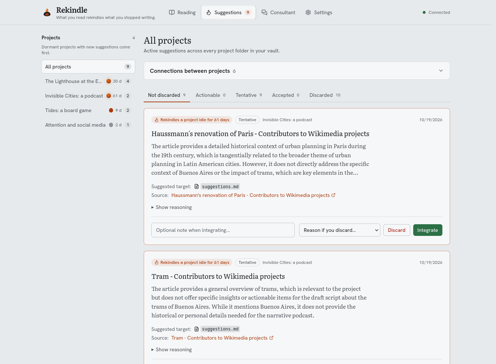
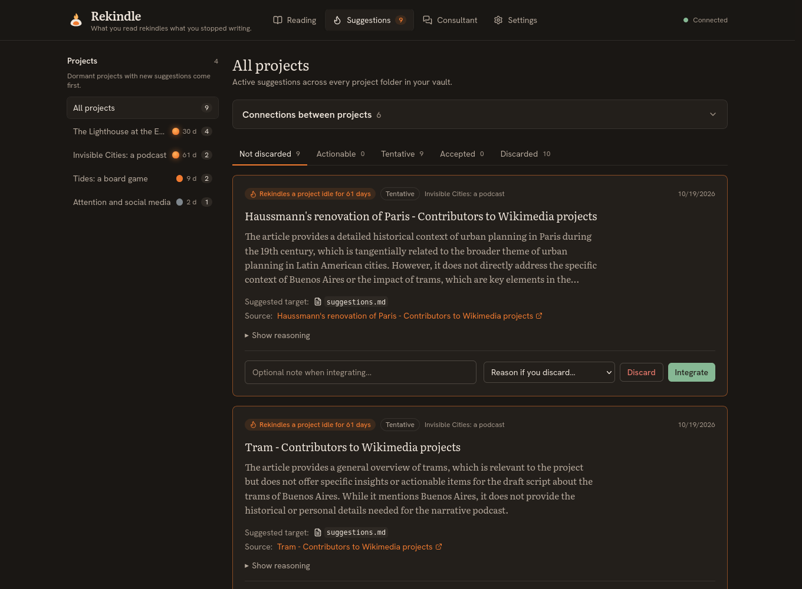

# Rekindle

[](https://github.com/Corcholog/rekindle/actions/workflows/ci.yml)

**What you read rekindles what you stopped writing.**

Writing projects get set aside for weeks, and then you read something that connects to one of them without noticing. Rekindle is a **local-first** assistant that notices for you. You keep your projects as Markdown notes in an Obsidian vault and clip the articles and YouTube videos you read. When a page can't be read (a PDF, a blocked site, a paywall), Rekindle says why and you can paste the text instead. Rekindle summarizes each one, compares it with every project and note, and proposes a concrete action ("cite this in the research notes", "use this as a counter-argument"). Projects you haven't touched in a while cool down to ash, and a suggestion that could relight one is marked. Rekindle never edits your notes: a suggestion you accept is added to a `suggestions.md` file in that project.

| Light | Dark |
|---|---|
|  |  |

Rekindle runs in **English or Spanish** (interface, suggestions and what it writes to your vault).

## How it works


- **Clip anything you read**: paste a link in the web UI or use the browser extension (`extension/`), which queues clips while Rekindle is offline. Web pages are read with Readability; YouTube videos through their transcripts.
- **Two-step matching**: local embeddings (`bge-m3` on Ollama) and pgvector find the 3 closest projects and notes; an LLM then judges each pair as actionable, tentative or irrelevant and proposes an action for a specific note. Providers are tried in order: DeepSeek, Gemini, then local `qwen2.5:7b-instruct`; without API keys everything runs locally.
- **Projects cool down**: each project burns while you work on it, cools to embers after a week and turns to ash once dormant; dormant projects with new suggestions come first.
- **You decide**: accepting appends an Obsidian callout to `<project>/suggestions.md`, linking to the suggested note (an existing one, or a new one Obsidian creates when you click the link). Pending, tentative and discarded suggestions never touch the vault.
- **Beyond single suggestions**: connections between your own projects, a research consultant that answers questions across your library and notes, and briefs compiled from accepted suggestions, all saved only when you ask.

Your projects are folders inside `Projects/` (or `Proyectos/`) in your vault:

```
<vault>/
  Projects/            (or Proyectos/)
    My_Project/
      ideas.md         ← note tagged #project (or frontmatter tags: [project])
      chapter1.md      ← any markdown note
      research/
        sources.md     ← recursive subdirectories are fully indexed
      suggestions.md   ← written by Rekindle, ignored when reading
```

Notes inside project folders are indexed recursively. No mandatory `project.md` file is required. Attachments and `.obsidian` configurations are safely ignored.

## Quick start

You need Node.js 22+, pnpm (via `corepack enable`), Docker and [Ollama](https://ollama.com); a DeepSeek or Gemini API key is optional. Full requirements and configuration: [docs/SETUP.md](docs/SETUP.md).

```bash
ollama pull bge-m3 && ollama pull qwen2.5:7b-instruct
git clone https://github.com/Corcholog/rekindle.git && cd rekindle
corepack enable && pnpm install
./start.sh        # copies .env.example, starts Postgres, migrates, checks the install, starts the server
```

Open <http://127.0.0.1:3000>. Until you point it at your vault (Settings, or `VAULT_PATH`), Rekindle uses a demo vault with 4 projects. Paste the links from [`demo_vault_en/ARTICLES.md`](demo_vault_en/ARTICLES.md) into **Reading**, wait for the summaries, and open **Suggestions**. Windows has `start.bat`, which has not been tested on a real Windows machine.

## Evaluation

I labeled 47 articles × 8 of my projects (376 pairs) by hand and ran Rekindle's real retrieval and triage against them, one model at a time:

| | Gemini 3.1 Flash Lite | **DeepSeek Flash** (default) | DeepSeek Flash, thinking on | Qwen 2.5 7B (local) |
|---|---|---|---|---|
| `actionable` precision / recall | 64% / 91%* | **95% / 60%** | 79% / 89%* | 100% / 31%† |
| Connections found (of 56) / extra | 49 / 25* | 35 / 4 | 49 / 26* | 30 / 9† |
| Triage macro-F1 | 0.69* | **0.64** | 0.71* | 0.57† |
| Latency p50 | 4.4 s* | **1.8 s** | 4.1 s* | 7.2 s† |

The default column is the current setup: since 2026-10-21 the model sees every note of the project and writes each suggestion as a headline with steps, and its reasoning as the connection first and then what is missing; since 2026-10-23 long notes are matched section by section (chunking), and the model writes its reasoning before its verdict. That last change is a deliberate trade: with the verdict first the model often called a pair tentative and then wrote that nothing connects (14 of 39 tentatives), and found 44 connections with 22 extra (89% / 69%, macro-F1 0.70); with the reasoning first no tentative contradicts itself, extras fall to 4, and 9 real connections are lost. Without chunking the verdict-first prompt found 42 connections with 19 extra (92% / 63%, macro-F1 0.69). \* Measured with the prompt of 2026-10-19. † Measured with the prompt before the structured text (2026-10-21), not repeated. The prompt just before the structured text scored macro-F1 0.75 and 0.72 in two runs (45 and 44 connections, `actionable` 96% / 77% and 96% / 71%); the same prompt run twice changes the verdict of 11 or 12 of the 118 pairs, so a gap of 0.03 is within noise. The structured prompt also returned 9 answers that were not valid JSON, 2 of them on both tries (in the app those fall back to the next provider). The shape found in a later diagnostic run, an action closed too early and one brace too many (6 of 6 failures there), is now repaired; whether the 9 had that shape is not verified.


What counts as a connection is partly subjective: a model can force links, and it can also find ones I had missed (after reading the thinking-on answers I changed 7 labels, which favors it). *Extra* means a pair I labeled irrelevant that the model connected. This is one labeler and a small dataset, so gaps of a few points are noise. Method, caveats, costs and the language experiments: [docs/EVALUATION.md](docs/EVALUATION.md).

## Privacy and security

Embeddings are always computed locally. If `GEMINI_API_KEY` is set, the following leaves your machine for Google's API:

- the article text (up to 50,000 characters) for summarisation;
- for each evaluation and re-evaluation, **up to 60,000 characters of your project notes** (and the path and title of every note in the project), plus the article summary;
- for each Consultor question, your question plus **the summaries of the 15 library items and snippets of the 15 project notes closest to it** (under 63,000 characters in all);
- for synergies, note snippets from both projects; for backlog synthesis, your accepted suggestions plus up to 60,000 characters of project notes.

With a `DEEPSEEK_API_KEY` set (the default chain is `deepseek,gemini,ollama`), the same content goes to DeepSeek first (a China-hosted API) and to Gemini only if DeepSeek fails; without that key DeepSeek is skipped. Leave both keys empty and every LLM call runs on local Ollama. Rekindle still contacts the sites you ingest (and YouTube for transcripts). The web UI's fonts are bundled, so opening it contacts nothing outside your machine.

Rekindle is a single-user, local-only tool:

- **Network:** the API has no login. It only binds to loopback (`HOST` must be `127.0.0.1`, `localhost` or `::1`), and it rejects requests addressed to any other host name, which blocks DNS rebinding. It also rejects state-changing requests from other web origins. The browser extension may only call `/api/ingest`.
- **Your vault:** Rekindle writes only when you act. **Accept** appends a callout to `<project>/suggestions.md`; **Save to Obsidian** saves a synergy note or research brief as a new file and never overwrites one. Model text is sanitized first: code blocks, embeds, HTML and fake callouts are neutralized.
- **Ingestion:** only public `http(s)` pages are fetched. Every resolved IP address and every redirect is checked, and pages are capped at 5 MB.
- **Prompt injection:** pages and notes are untrusted. Their text is delimited so it cannot break out of its block, every prompt says delimited text is data, and the limits that matter are enforced in code: a suggestion can only point at an existing note of its project, and nothing reaches the vault unless you accept it, sanitized.

The full list of threats, mitigations, tests and residual risks is in [docs/THREAT_MODEL.md](docs/THREAT_MODEL.md).

## Known limitations

- **Retrieval barely filters.** 94% of unrelated articles still retrieve a project at the 0.6 distance threshold, so only the 3 closest projects reach the LLM; that cutoff drops 7 of the 56 labeled connections before any model sees them.
- **`tentative` verdicts are weak** for every model tried (F1 0.28–0.48 on 21 pairs).
- **Usefulness is not measured.** Only verdicts are scored, against one person's labels.
- **A failed evaluation is invisible in the UI**: after three retries it waits until the project changes; `pnpm telemetry:report` shows it.
- **The Consultor reads only the 15 items and 15 notes closest to your question**, found by embedding similarity, so a question that needs the whole library ("how many articles do I have on X?") gets an answer about that selection. Answer quality is not measured.
- **Idle time comes from file modification dates**, so copying or syncing a vault in a way that rewrites them resets it.

## Documentation

| Document | Content |
|---|---|
| [docs/SETUP.md](docs/SETUP.md) | Requirements, configuration, commands, HTTP API, languages, troubleshooting |
| [docs/EVALUATION.md](docs/EVALUATION.md) | Evaluation results, caveats and costs |
| [docs/ARCHITECTURE.md](docs/ARCHITECTURE.md) | Architecture, data model, pipelines, API contracts |
| [docs/THREAT_MODEL.md](docs/THREAT_MODEL.md) | Threats, mitigations, the test behind each, residual risks |
| [docs/JOURNEY.md](docs/JOURNEY.md) | Build log: decisions, dead ends, bugs found and fixed |
| [docs/adr/](docs/adr) | Architecture decision records (Spanish) |

## License and citation

Rekindle is released under the [Apache License 2.0](LICENSE). You may use, modify and redistribute it, including commercially; redistributions and derivative works must keep the [`NOTICE`](NOTICE) file, which credits the author. To cite Rekindle, use GitHub's *Cite this repository* button or [`CITATION.cff`](CITATION.cff).

Built by Giorgio Ivan Loguercio ([GitHub](https://github.com/Corcholog) · [LinkedIn](https://www.linkedin.com/in/corcho-log/)).
